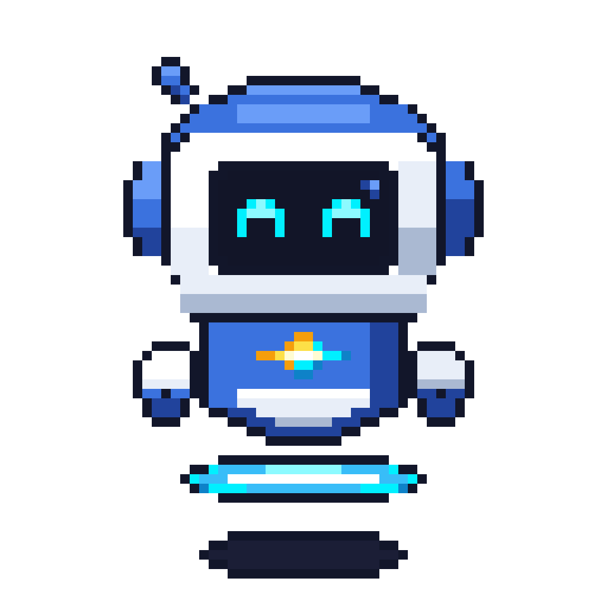

<div align="center">

# 🤖 AG Pet (Gravi)

**Интерактивный плавающий питомец-компаньон для Google Antigravity IDE**

[](LICENSE)
[](https://www.typescriptlang.org/)
[](https://www.electronjs.org/)
[](tests/)

<br />



<p>
  <b>Gravi</b> — это легковесный, прозрачный питомец на рабочий стол, синхронизированный в реальном времени с состоянием AI-агента Antigravity IDE. Он визуально и звуковыми эффектами сообщает, когда агент думает, выполняет задачи, ждёт ввода от пользователя или завершил работу.
</p>

</div>

---

## ✨ Ключевые возможности

- 🎨 **Пиксель-арт рендерер (60 FPS)**: Высококачественный спрайтовый движок на Canvas с поддержкой масштабирования без размытия (`1x`, `1.5x`, `2x`).
- 🔄 **Реактивные состояния**:
  - `idle` (`^ ^`) — режим ожидания, плавное покачивание и парение антигравитационного кольца.
  - `running` — агент выполняет команды и пишет код.
  - `needs_input` (`? ?`) — агент задал вопрос или ждёт действия пользователя.
  - `ready` (`★ ★`) — задача успешно завершена (с праздничной анимацией и звуковым сигналом).
  - `blocked` (`X X`) — ошибка или блокировка в пайплайне.
  - `dragging` — реакция на перетаскивание курсором.
  - `waving` — приветствие и интерактивность.
- 🪟 **Прозрачный Always-On-Top оверлей**: Безрамочное окно Electron с поддержкой прозрачности и перетаскивания через несколько мониторов.
- 💬 **Интерактивный тултип**: При наведении курсора отображает текущий шаг и краткое описание действий AI-агента.
- 🎯 **Быстрый фокус IDE**: Клик по питомцу мгновенно переносит фокус в окно Antigravity IDE.
- 🔊 **Ретро-синтезатор (Web Audio API)**: Процедурные звуковые эффекты без внешних аудиофайлов (с возможностью мгновенного Mute).
- 🛡️ **Watchdog процесса**: Питомец автоматически завершает работу при закрытии или перезапуске родительского процесса Antigravity.
- 🔌 **Интеграция с расширением**: Модуль отслеживания логов (`transcript.jsonl`) и локальный WebSocket/IPC мост.

---

## 🏗 Архитектура проекта

Проект разделен на независимые модули:

```text
AG_Pet/
├── assets/             # Спрайты и графические ассеты (PNG)
├── desktop-overlay/    # Electron-приложение прозрачного оверлея
│   ├── main/           # Жизненный цикл окна, IPC, системный трей/меню
│   └── renderer/       # UI слой, тултипы, обработка событий
├── extension/          # Расширение для Antigravity / VS Code
│   └── src/            # File watcher (transcript.jsonl), WebSocket сервер
├── shared/             # Общие TypeScript-интерфейсы и константы
├── sprite-engine/      # Спрайтовый движок (Canvas renderer, аниматор, Web Audio)
├── scripts/            # Скрипты запуска, демоны и генераторы ассетов
└── tests/              # Полный набор E2E тестов (161 тест, Tiers 1-4)
```

---

## 🚀 Быстрый старт

### Требования
- **Node.js** >= 18.0.0
- **npm** >= 9.0.0

### Установка зависимостей

```bash
# Клонирование репозитория
git clone https://github.com/lennielan/AG_Pet.git
cd AG_Pet

# Установка зависимостей корневого проекта и модулей
npm install
npm install --prefix desktop-overlay
npm install --prefix extension
```

### Сборка проекта

```bash
npm run build
```

### Запуск оверлея

```bash
npm start --prefix desktop-overlay
```

---

## 🧪 Тестирование

Проект покрыт многоуровневым набором сквозных и интеграционных тестов:

```bash
npm test
```

> **Статус**: 161/161 тестов успешно проходят (покрытие функций F01–F14, граничных условий, кросс-модульной интеграции и сценариев реальной нагрузки).

---

## ⚙️ Управление

- **ЛКМ (зажать)** — перетаскивание питомца по экрану (позиция сохраняется).
- **ЛКМ (клик)** — переключение фокуса на Antigravity IDE.
- **ПКМ** — контекстное меню:
  - Выбор масштаба: `1x`, `1.5x`, `2x`
  - Звук: `Mute` / `Unmute`
  - Выход: `Hide` / `Quit`

---

## 📄 Лицензия

Распространяется под лицензией [MIT](LICENSE).
Copyright (c) 2026 [lennielan](https://github.com/lennielan).
