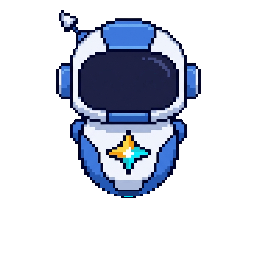

<div align="center">

# AG Pet (Gravi)

**Интерактивный плавающий робот-компаньон для Google Antigravity и Antigravity IDE**

[](LICENSE)
[](https://www.typescriptlang.org/)
[](https://www.electronjs.org/)
[](tests/)

<br />



<p>
  <b>Gravi</b> — это легкий прозрачный виджет рабочего стола, полностью синхронизированный в реальном времени с жизненным циклом и активностью AI-агента как в <b>Google Antigravity (CLI / standalone-режим)</b>, так и в <b>Antigravity IDE (VS Code / расширение)</b>. Робот визуально и звуковыми эффектами реагирует на текущие действия агента, поддерживает многомониторное перетаскивание, поглаживания мышью, управление через HUD-меню и интеграцию с системным треем.
</p>

</div>

---

## Поддержка сред Antigravity

Проект изначально спроектирован для бесшовной работы в двух режимах окружения:

1. **Обычный Antigravity (Standalone / CLI / Background Session)**:
   - Включает автономный файловый монитор, отслеживающий директорию сессий агента (`~/.gemini/antigravity/brain/**/transcript.jsonl`).
   - Автоматически считывает запуск инструментов, выполнение команд и шаги размышления агента без необходимости открывать IDE.
   - Фоновый супервизор (`scripts/ag-pet-service.js`) автоматически поднимает оверлей при обнаружении процесса `Antigravity.exe` и завершает его при закрытии.

2. **Antigravity IDE (VS Code Fork / Интерактивный редактор)**:
   - Включает встроенное расширение (`extension/`), активирующееся по событию `onStartupFinished`.
   - Обеспечивает мгновенный фокус на активное окно редактора по одиночному клику на персонажа.
   - Предоставляет команды палитры (`Ctrl+Shift+P`), управление жизненным циклом и локальный WebSocket-мост для нулевой задержки событий.

---

## Возможности

- **Скелетный 2D-рендерер (60 FPS)**: Высококачественный спрайтовый движок на HTML5 Canvas с поддержкой масштабирования без размытия (1.0x, 1.5x, 2.0x).
- **Синхронизация состояний агента в реальном времени**:
  - `idle` (арки улыбки) — режим ожидания, плавное дыхание и парение.
  - `thinking` (фокусировка LED-экрана, отслеживание взгляда, парящие мысли) — агент анализирует контекст или формирует план. Задумчивый жест руки у подбородка и мягкие пузырьки мыслей.
  - `running` (анимация кодинга за парящим ноутбуком) — агент выполняет вызовы инструментов, редактирует файлы или выполняет команды. Грави сосредоточенно набирает код на голографическом ноутбуке с активной артикуляцией пальцев и сфокусированным взглядом.
  - `needs_input` (янтарные вопросительные знаки) — агент ожидает ответа пользователя или подтверждения действия.
  - `ready` (золотые звезды) — задача успешно завершена, праздничная анимация и звуковой аккорд.
  - `blocked` (красные крестики) — ошибка выполнения или отказ инструмента.
  - `sleeping` (закрытые глаза, парящие буквы Zzz) — автоматический переход в спящий режим при 3 минутах неактивности.
  - `dragging` — динамический наклон тела и реакция на физику перетаскивания.
  - `headpat` (довольный румянец, сияющие сердечки) — интерактивная реакция на поглаживание по голове.
- **Интерактивные поглаживания (Headpat)**: Проведите курсором мыши влево-вправо по голове Грави, чтобы погладить его. Робот смущенно зардеет, выпустит пиксельные сердечки, издаст мурчащий звук и покажет благодарную реплику.
- **Прозрачный Always-On-Top оверлей**: Безрамочное окно Electron поверх всех окон с поддержкой многомониторных конфигураций, отсутствием лишних иконок на панели задач (`skipTaskbar`) и сквозного клика (Click-Through) вне активного контура персонажа.
- **Интерактивный статус-бейдж**: Тултип над питомцем с пиксельной иконкой и текстовым описанием текущего шага агента на русском языке.
- **HUD-панель управления**: Полупрозрачное меню по правому клику с возможностью выбора масштаба, ручного тестирования всех состояний, отключения звука и скрытия.
- **Системный трей Windows**: Иконка в трее возле часов с быстрым доступом к настройкам, масштабу, звуку, автозапуску и сбросу позиции.
- **Глобальная горячая клавиша**: Сочетание `Ctrl+Shift+G` мгновенно скрывает или возвращает Грави на экран из любого приложения.
- **Процедурный синтезатор (Web Audio API)**: Звуковые эффекты переходов без внешних аудиофайлов (с возможностью мгновенного отключения).
- **Watchdog процессов**: Автоматическое корректное завершение оверлея при закрытии родительского процесса Antigravity.

---

## Архитектура проекта

```text
AG_Pet/
├── assets/             # Графические ассеты персонажа (спрайты, голова, тело, руки, ноутбук)
├── desktop-overlay/    # Electron-приложение прозрачного оверлея
│   ├── main/           # Жизненный цикл окна, трей, глобальные хоткеи, автономный watcher
│   └── renderer/       # Canvas-рендеринг, HUD-меню, статус-бейдж, физика поглаживания
├── extension/          # Расширение для Antigravity IDE / VS Code
│   └── src/            # Мониторинг transcript.jsonl, машина состояний, WebSocket-мост
├── shared/             # Общие TypeScript-типы, интерфейсы и константы
├── sprite-engine/      # Модульный аниматор, рендерер и процедурный Web Audio синтезатор
├── scripts/            # Фоновые демоны, сервис автозапуска и скрипты экспорта графики
└── tests/              # Набор сквозных тестов (Tiers 1-4, 161 тест)
```

---

## Руководство пользователя

### 1. Установка и подготовка окружения

Убедитесь, что в системе установлены **Node.js** (версии 18 или выше) и **npm**.

Клонируйте репозиторий и установите зависимости:

```bash
git clone https://github.com/lennielan/AG_Pet.git
cd AG_Pet

npm install
npm install --prefix desktop-overlay
npm install --prefix extension
```

Скомпилируйте проект:

```bash
npm run build
```

---

### 2. Запуск и варианты использования

#### Режим 1. Использование с обычным Antigravity (CLI / Standalone)

Для работы с автономным агентом Antigravity:

1. Запустите оверлей:
   ```bash
   npm start --prefix desktop-overlay
   ```
2. Оверлей автоматически подключит встроенный автономный монитор логов к директории `~/.gemini/antigravity/brain`.
3. При каждом запросе в Antigravity CLI или фоновом выполнении задач робот будет автоматически оживать, показывать статус работы и оповещать о завершении.
4. Для автоматического запуска вместе с Windows можно использовать встроенный сервис:
   ```bash
   node scripts/ag-pet-service.js
   ```
   (или включить чекбокс «Автозапуск с Windows» в меню системного трея).

#### Режим 2. Использование внутри Antigravity IDE

Если вы работаете в интерактивной среде Antigravity IDE:

1. Скомпилированное расширение из папки `extension/` активируется автоматически при старте редактора (`onStartupFinished`).
2. Расширение самостоятельно запускает оверлей, связывается с ним по WebSocket и передает PID процесса для контроля завершения.
3. Доступные команды в палитре (Ctrl+Shift+P):
   - `AG Pet: Toggle Floating Companion` — показать или скрыть питомца.
   - `AG Pet: Restart Companion` — перезапустить процесс оверлея.
   - `AG Pet: Focus Antigravity IDE` — вернуть фокус в редактор.

---

### 3. Взаимодействие и горячие клавиши

- **Перемещение**: Зажмите левую кнопку мыши (ЛКМ) на Грави и перетащите его в любую точку экрана (поддерживаются мультимониторные конфигурации). Координаты сохраняются автоматически.
- **Возврат в окно Antigravity**: Одинарный клик ЛКМ по персонажу мгновенно переносит системный фокус в окно Antigravity IDE.
- **Поглаживание (Headpat)**: Быстро проведите курсором мыши влево-вправо по верхней части головы робота. Грави покажет сердечки, смущенный взгляд и поблагодарит за заботу.
- **Глобальный хоткей**: Нажмите `Ctrl+Shift+G` в любом месте системы, чтобы моментально спрятать или вернуть питомца на рабочий стол.
- **HUD-панель (ПКМ)**: Клик правой кнопкой мыши по персонажу открывает панель управления:
  - **МАСШТАБ**: переключение между `1.0x` (128px), `1.5x` (192px) и `2.0x` (256px).
  - **ТЕСТ СОСТОЯНИЙ**: ручная проверка любой анимации (`Покой`, `Мысли`, `Работа`, `Готово`, `Ввод`, `Ошибка`, `Сон`).
  - **Звук**: быстрое включение и выключение звуковых эффектов.
  - **Скрыть**: сворачивание оверлея в трей.
- **Системный трей Windows**: Кликните по иконке Грави возле системных часов для восстановления окна или сброса позиции в правый нижний угол экрана.
- **Прозрачный клик**: Вся область окна за пределами тела робота полностью прозрачна для курсора и не мешает кликать по окнам других приложений.

---

## Тестирование

Проект полностью верифицирован автоматизированным тест-раннером:

```bash
npm test
```

Набор включает 161 сквозной тест (покрытие функций F01–F14, граничные условия, устойчивость IPC-моста, ротация файлов логов и сценарии многочасовой непрерывной работы).

---

## Лицензия

Проект распространяется под свободной лицензией [MIT](LICENSE).
Copyright (c) 2026 [lennielan](https://github.com/lennielan).
